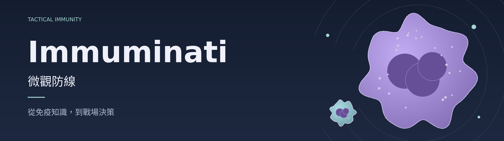

[線上遊玩 →](https://sces5504.github.io/Immuminati/)



[](https://sces5504.github.io/Immuminati/) [](https://github.com/sces5504/Immuminati)

# 在微觀世界裡，理解免疫防線

Immuminati · 微觀防線是一款繁體中文的免疫學即時戰術遊戲。為想透過互動理解免疫機制的玩家而設計：部署細胞、暫停調度，再觀察吞噬、抗原呈現與細胞協作如何影響感染及組織保全。六種感染情境從開場即可選擇，桌面與手機皆有對應操作。

## 從部署到理解

- **先安排，再行動。** 每關新局以 12 部署點選擇知識套組或自行配置隊伍，調整起始防區；確認後仍維持暫停，由你決定何時開始。
- **依機制組織防線。** 14 種免疫細胞／狀態可募集或分化；補體 C3b 與抗體有各自的作用期限，抗體供應連結 B 細胞、T 細胞幫助與漿細胞分化。募集需消耗資源並等待到場。
- **看清結果與原因。** 關內教學、百科、因果紀錄與組織／胞內剖視，協助區分胞外病原、吞入後的活負荷與感染宿主。吞入不等於殺死，控制感染也不一定等於滅菌。
- **按自己的節奏觀察。** 隨時暫停、撤銷暫停中的指令或切換 2×；自動尋敵預設開啟，手動移動優先。回主頁會保存並暫停當前局，支援本機續玩與存檔匯入／匯出。

## 六種感染情境

| 關卡 | 觀察與決策重點 |
| --- | --- |
| M1 肺炎鏈球菌 | 莢膜、補體／抗體調理、吞入與胞內殺菌 |
| M2 鼠傷寒沙門氏菌 | 腸黏膜、巨噬細胞含菌囊泡、Th1／IFN-γ 支援 |
| M3 結核分枝桿菌 | 肺部既存感染焦點、局部圍堵與組織保全；不要求滅菌 |
| M4 A 型流感病毒 | 胞外病毒與感染上皮、IFN-I、NK、DC 交叉呈遞及 CD8 |
| M5 白色念珠菌 | 口腔上皮、酵母／菌絲、Th17／ILC3 與顆粒防禦 |
| M6 HIV | 淋巴組織中的易感、產毒與潛伏宿主，以及 CD4 免疫支援 |

M6 採持續防守，直到全部防區組織耗盡才給予特殊、無星等結果；沒有倒數期限，也不以清場獲勝。各關機制與生物學依據見[六關實作紀錄](docs/CAMPAIGN-IMPLEMENTATION.md)。

## 開始遊玩

1. 開啟[線上版本](https://sces5504.github.io/Immuminati/)，選擇感染情境。第一次可從 M1 與關內教學開始。
2. 選擇知識套組或自行部署，以暫停狀態安排隊伍；選取細胞後，指定菌群或位置，再開始行動。
3. 需要調整時先暫停，搭配增援、調理與因果紀錄觀察結果。手機可單指拖曳、雙指縮放，也可用 ＋／− 調整視野。

進度儲存在目前瀏覽器，不會自動跨裝置同步；換裝置前請先匯出存檔。後續只保證現行規則存檔，不再持續新增歷史版本遷移；既有遷移與備份機制保留，不清除玩家資料。

## 科學範圍與素材

免疫數值、時間、群體負荷與組織結構為教學抽象，未涵蓋完整全身反應或胚中心。HIV 情境未模擬抗反轉錄病毒治療（ART），其結局不代表臨床病程。詳細依據與限制見[核心生命週期紀錄](docs/CORE-LIFECYCLE.md)。

素材來源與使用條款見[美術紀錄](docs/art/tripo-expansion/README.md)，未另行宣稱 CC0 或專業醫學建模認證。實體 iPhone Safari／Android GPU、真人難度回饋與大量單位壓測仍待驗證。

## 本機開發

使用 Node.js 24，依賴版本鎖定於 `package-lock.json`：

```sh
npm ci
npm run dev
```

開啟 `http://localhost:5173/Immuminati/`。正式建置以 `/Immuminati/` 作為 Pages 子路徑。

```sh
npm run verify
npm run preview
```

`verify` 執行單元測試、型別檢查與正式建置；瀏覽器檢查另行執行。歷次實測與發布限制見[正式版本證據](docs/evidence/main-release/README.md)，不代表本次文件修改重新通過同一批測試。

<details>
<summary>瀏覽器驗證命令與開發文件</summary>

需要瀏覽器環境時，先安裝 Chromium，再依改動執行相關項目：

```sh
npx playwright install --with-deps chromium
npm run test:browser
npm run test:animation
npm run test:immune
npm run test:anatomy
npm run test:clarity
npm run test:campaign
npm run test:campaign-ui
npm run test:deployment
npm run test:deployment-policy
node scripts/campaign-compartments.mjs
```

`DEVICE=desktop|mobile`、`CASE=m1|...|m6` 可限定六關驗證；`TARGET_URL` 指向公開站時，驗證實際發布版本。受控時鐘在載入遊戲前安裝／暫停，仍透過正式 UI 與 RAF 固定步進，不注入通關狀態。胞內剖視檢查使用實際遊玩累積的病原來源。

現行存檔為 schema 2、規則 3.2、內容 `campaign.3`。正式入口為 `src/tactics`，使用 TypeScript、Vite、React 與 Three.js，分為 domain、content、engine、application、presentation、UI 與 persistence。

- 接續開發：[專案指引](AGENTS.md) · [現行規格](docs/Immuminati-spec.md) · [展示與動畫](docs/art-direction/C-art-and-animation.md) · [開發交接](docs/CLOUD-HANDOFF.md)
- 操作與素材：[部署與手勢](docs/DEPLOYMENT-AND-GESTURES.md) · [美術建模交接](docs/ART-HANDOFF-PROMPT.md)
- 歷史紀錄：[v3.0 六關驗證](docs/CAMPAIGN-VERIFICATION.md) · [v2.4 UI 精簡](docs/UI-CLARITY.md) · [胞內區室](docs/TISSUE-COMPARTMENTS.md) · [v2.2 免疫擴充](docs/IMMUNE-EXPANSION.md) · [立體基準](docs/TACTICAL-VALIDATION.md)

歷史測試數字、截圖與影片只代表各自記錄的版本。

</details>
