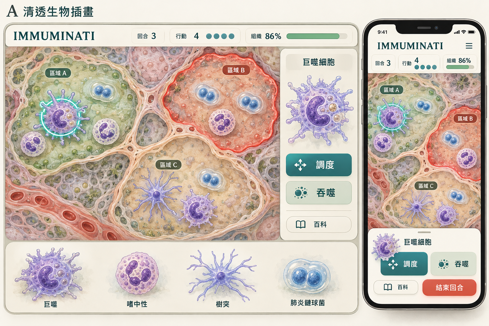
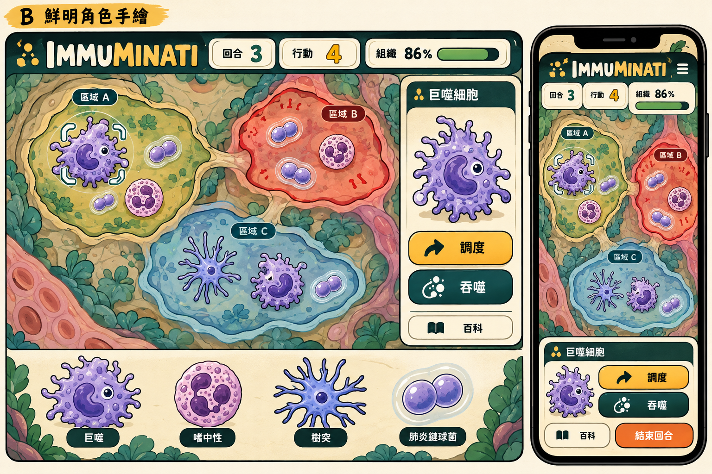
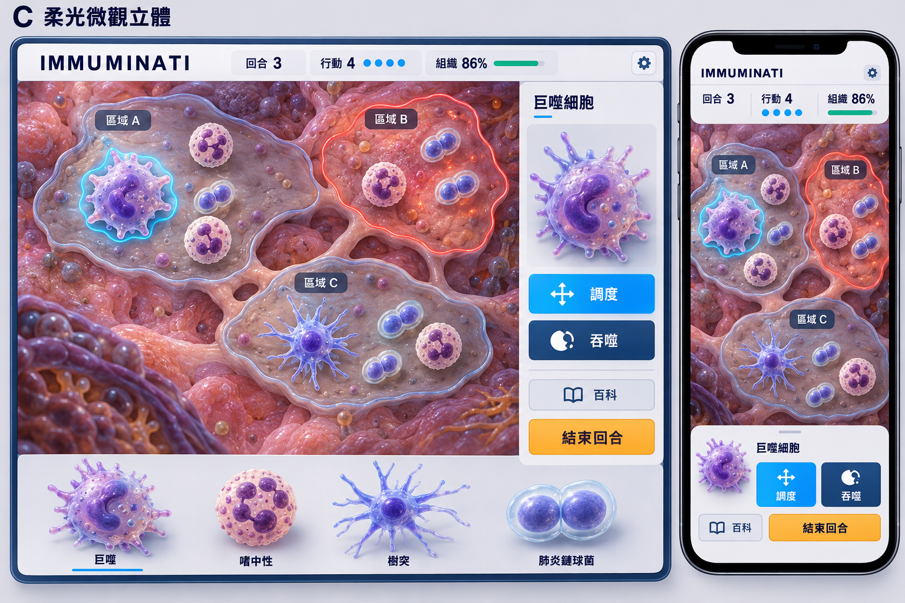
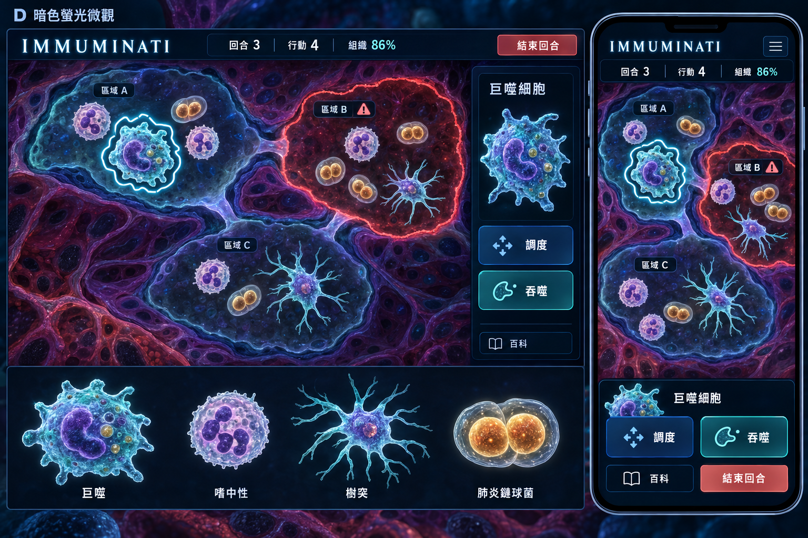

# Immuminati 美術方向：C 已選定

日期：2026-10-17

使用者已選定 **C「柔光微觀立體」**，並要求細胞待機漂浮與各動作的對應動畫。正式製作以 [主規格 v1.1](../Immuminati-spec.md) 與 [C 美術與動畫規格](C-art-and-animation.md) 為準。

以下保留內建 image_gen 製作的四款歷史比較圖與完整提示，採同一肺炎鏈球菌情境。A／B／D 不作正式方向。所有圖片均是概念預覽，正式去背、分層、動作及互動介面仍需製作。

| 代號 | 方向 | 比較重點 |
| --- | --- | --- |
| A | 清透生物插畫 | 溫和、知識感、細胞結構辨識 |
| B | 鮮明角色手繪 | 角色記憶點、明確輪廓、遊戲感 |
| **C（已選定）** | **柔光微觀立體** | **立體材質、組織深度、微觀臨場感；正式採用** |
| D | 暗色螢光微觀 | 深色對比、螢光細節、戰局張力 |

## 圖片

四張預覽皆已用內建 image_gen 產生並保存本目錄；原始生成檔保留。C 是已選參考，圖片不作為已完成的遊戲介面或可直接使用的拆分素材。

### A 清透生物插畫



### B 鮮明角色手繪



### C 柔光微觀立體



### D 暗色螢光微觀



## 檢視紀錄

- 四個方向均已目視檢查，包含桌面／手機、區域邊界、主要操作與四種造型比較。
- A：生物插畫與柔和紙感；正式背景可再降低細節密度。
- B：輪廓、角色辨識與按鈕對比鮮明；可再調整擬人化程度及背景的組織感。
- C：立體微觀材質最鮮明；正式素材需維持小尺寸下的形狀與對比。
- D：深色螢光對比與氣氛突出；正式素材需控制發光量與背景細節。
- 圖片為美術概念；字體、細胞比例與數量、操作資訊量、真正可互動版型與無障礙條件依 C 製作規格落實。
- C 已選定，正式製作統一輪廓、材質、色彩與介面，不自行混搭其他方向。

## 完整生成提示

以下為實際使用的提示集；每個方向以獨立內建工具呼叫產生，不指定模型、API 或 CLI。

### A 清透生物插畫

```text
Use case: ui-mockup.
Asset type: one polished art-direction preview board for Immuminati, a browser turn-based immunology strategy game for university students, equally usable on computer and phone. This is a visual style exploration with actual game-like UI, not a marketing poster.
Composition: wide landscape 3:2 artboard. One large desktop gameplay screen on the left covering roughly 72 percent width, one clearly readable portrait mobile version on the right. Along the bottom of the desktop area, a compact lineup of three immune cell designs and one bacterium. Flat front-facing UI, no photographed laptops, no hands. Desktop has a selected-unit sidebar, phone uses a bottom action panel. Restrained amount of UI, generous readable spacing.
Shared scene for every direction: the same early pneumococcal infection mission, turn 3, four action points and tissue integrity 86 percent. A top-down semi-abstract living tissue map with exactly three irregular selectable connected tissue regions, not a hex or square grid. A few immune-cell population tokens and paired encapsulated round bacteria occupy the regions. One region is stressed with a restrained red warning outline; one macrophage is selected. Region position must look tactically meaningful, with visible narrow connections.
Biological visual anchors: macrophage = larger irregular amoeboid outline, pseudopods, curved nucleus and small vesicles; neutrophil = pale cell with distinctly multilobed nucleus and fine granules; dendritic cell = slender branching processes; Streptococcus pneumoniae = paired rounded cocci enclosed in a translucent capsule halo. Keep cell types clearly different in silhouette. Cells are organisms, without outfits, weapons or equipment.
Exact sparse UI text in Traditional Chinese, crisp high contrast: title "IMMUMINATI" (I-M-M-U-M-I-N-A-T-I), "回合 3", "行動 4", "組織 86%", "區域 A", "區域 B", "區域 C", "巨噬細胞", "調度", "吞噬", "百科", "結束回合". Character lineup may use only the short labels "巨噬", "嗜中性", "樹突", "肺炎鏈球菌". No paragraphs or lorem ipsum. Desktop and phone show matching game state.
Constraints: readable hierarchy, clean deliberate UI, large mobile touch targets, no heavy texture behind text, no generic financial dashboard, no fantasy armor, no attack lasers, no gore, no HIV story spoilers, no medical equipment props, no watermark. The selected unit panel shows one clear cell portrait and two action buttons; the bottom row is a visual roster, not an upgrade shop.

Art direction A — CLEAR BIOLOGICAL ILLUSTRATION. On the outer artboard only, label "A 清透生物插畫". Warm ivory and pale sage UI surfaces, teal selection, muted coral threat accent. Delicate ink contour with layered translucent watercolor/gouache-like cell illustration, sophisticated contemporary natural-history illustration. Tissue is a softly painted organic substrate with a little genuine biological structure, plenty of quiet space. Cells feel alive and tactile but are non-anthropomorphic, with visible nuclei and internal granules, no faces. Elegant rounded flat panels and restrained shadows, precise typography. Friendly and intellectually credible for adult students, inviting, calm, highly legible. Avoid toy-like forms or overly pale low-contrast controls.
```

### B 鮮明角色手繪

```text
Use case: ui-mockup.
Asset type: one polished art-direction preview board for Immuminati, a browser turn-based immunology strategy game for university students, equally usable on computer and phone. This is a visual style exploration with actual game-like UI, not a marketing poster.
Composition: wide landscape 3:2 artboard. One large desktop gameplay screen on the left covering roughly 72 percent width, one clearly readable portrait mobile version on the right. Along the bottom of the desktop area, a compact lineup of three immune cell designs and one bacterium. Flat front-facing UI, no photographed laptops, no hands. Desktop has a selected-unit sidebar, phone uses a bottom action panel. Restrained amount of UI, generous readable spacing.
Shared scene for every direction: the same early pneumococcal infection mission, turn 3, four action points and tissue integrity 86 percent. A top-down semi-abstract living tissue map with exactly three irregular selectable connected tissue regions, not a hex or square grid. A few immune-cell population tokens and paired encapsulated round bacteria occupy the regions. One region is stressed with a restrained red warning outline; one macrophage is selected. Region position must look tactically meaningful, with visible narrow connections.
Biological visual anchors: macrophage = larger irregular amoeboid outline, pseudopods, curved nucleus and small vesicles; neutrophil = pale cell with distinctly multilobed nucleus and fine granules; dendritic cell = slender branching processes; Streptococcus pneumoniae = paired rounded cocci enclosed in a translucent capsule halo. Keep cell types clearly different in silhouette. Cells are organisms, without outfits, weapons or equipment.
Exact sparse UI text in Traditional Chinese, crisp high contrast: title "IMMUMINATI" (I-M-M-U-M-I-N-A-T-I), "回合 3", "行動 4", "組織 86%", "區域 A", "區域 B", "區域 C", "巨噬細胞", "調度", "吞噬", "百科", "結束回合". Character lineup may use only the short labels "巨噬", "嗜中性", "樹突", "肺炎鏈球菌". No paragraphs or lorem ipsum. Desktop and phone show matching game state.
Constraints: readable hierarchy, clean deliberate UI, large mobile touch targets, no heavy texture behind text, no generic financial dashboard, no fantasy armor, no attack lasers, no gore, no HIV story spoilers, no medical equipment props, no watermark. The selected unit panel shows one clear cell portrait and two action buttons; the bottom row is a visual roster, not an upgrade shop.

Art direction B — BOLD HAND-DRAWN CHARACTER STRATEGY. On the outer artboard only, label "B 鮮明角色手繪". Cream paper-like UI, saturated forest teal and warm mustard accents with coral threats. Strong clean dark hand-ink outlines, expressive compact organic cell characters, two-tone cel shading, simple memorable silhouettes. Very subtle expressive eyes may be integrated without obscuring nuclei; no human limbs, costumes or weapons. The macrophage's pseudopods, neutrophil's multilobed nucleus and dendritic branches remain recognizable. Illustrated tissue regions feel like a charming modern tabletop tactics board, sparse and clearly bounded. High-contrast bold pill buttons and well-organized cards. Playful indie-game identity, appealing to adults rather than preschool educational cartoons. No childish stickers and no busy decorative patterns.
```

### C 柔光微觀立體

```text
Use case: ui-mockup.
Asset type: one polished art-direction preview board for Immuminati, a browser turn-based immunology strategy game for university students, equally usable on computer and phone. This is a visual style exploration with actual game-like UI, not a marketing poster.
Composition: wide landscape 3:2 artboard. One large desktop gameplay screen on the left covering roughly 72 percent width, one clearly readable portrait mobile version on the right. Along the bottom of the desktop area, a compact lineup of three immune cell designs and one bacterium. Flat front-facing UI, no photographed laptops, no hands. Desktop has a selected-unit sidebar, phone uses a bottom action panel. Restrained amount of UI, generous readable spacing.
Shared scene for every direction: the same early pneumococcal infection mission, turn 3, four action points and tissue integrity 86 percent. A top-down semi-abstract living tissue map with exactly three irregular selectable connected tissue regions, not a hex or square grid. A few immune-cell population tokens and paired encapsulated round bacteria occupy the regions. One region is stressed with a restrained red warning outline; one macrophage is selected. Region position must look tactically meaningful, with visible narrow connections.
Biological visual anchors: macrophage = larger irregular amoeboid outline, pseudopods, curved nucleus and small vesicles; neutrophil = pale cell with distinctly multilobed nucleus and fine granules; dendritic cell = slender branching processes; Streptococcus pneumoniae = paired rounded cocci enclosed in a translucent capsule halo. Keep cell types clearly different in silhouette. Cells are organisms, without outfits, weapons or equipment.
Exact sparse UI text in Traditional Chinese, crisp high contrast: title "IMMUMINATI" (I-M-M-U-M-I-N-A-T-I), "回合 3", "行動 4", "組織 86%", "區域 A", "區域 B", "區域 C", "巨噬細胞", "調度", "吞噬", "百科", "結束回合". Character lineup may use only the short labels "巨噬", "嗜中性", "樹突", "肺炎鏈球菌". No paragraphs or lorem ipsum. Desktop and phone show matching game state.
Constraints: readable hierarchy, clean deliberate UI, large mobile touch targets, no heavy texture behind text, no generic financial dashboard, no fantasy armor, no attack lasers, no gore, no HIV story spoilers, no medical equipment props, no watermark. The selected unit panel shows one clear cell portrait and two action buttons; the bottom row is a visual roster, not an upgrade shop.

Art direction C — SOFT MICROSCOPIC 3D. On the outer artboard only, label "C 柔光微觀立體". Cool off-white UI panels over warm rose-lilac tissue, deep navy readable text, cyan-blue interaction and amber threat accents. Beautiful stylized 3D biological forms with soft subsurface scattering, translucent membranes, visible sculpted nuclei, fine granules, satin organic material and soft ambient shadows. Top-down tissue regions look like low-relief living terrain, with depth kept subtle enough to preserve target boundaries. No eyes or human faces. Macrophage pseudopods and dendritic branches are distinctly modeled; encapsulated diplococci have readable translucent capsule shells. Crisp mostly flat controls contrast with the dimensional creatures, not glossy glass UI. Premium friendly microscopic diorama with controlled detail, not plastic toys, not photoreal clinical imagery.
```

### D 暗色螢光微觀

```text
Use case: ui-mockup.
Asset type: one polished art-direction preview board for Immuminati, a browser turn-based immunology strategy game for university students, equally usable on computer and phone. This is a visual style exploration with actual game-like UI, not a marketing poster.
Composition: wide landscape 3:2 artboard. One large desktop gameplay screen on the left covering roughly 72 percent width, one clearly readable portrait mobile version on the right. Along the bottom of the desktop area, a compact lineup of three immune cell designs and one bacterium. Flat front-facing UI, no photographed laptops, no hands. Desktop has a selected-unit sidebar, phone uses a bottom action panel. Restrained amount of UI, generous readable spacing.
Shared scene for every direction: the same early pneumococcal infection mission, turn 3, four action points and tissue integrity 86 percent. A top-down semi-abstract living tissue map with exactly three irregular selectable connected tissue regions, not a hex or square grid. A few immune-cell population tokens and paired encapsulated round bacteria occupy the regions. One region is stressed with a restrained red warning outline; one macrophage is selected. Region position must look tactically meaningful, with visible narrow connections.
Biological visual anchors: macrophage = larger irregular amoeboid outline, pseudopods, curved nucleus and small vesicles; neutrophil = pale cell with distinctly multilobed nucleus and fine granules; dendritic cell = slender branching processes; Streptococcus pneumoniae = paired rounded cocci enclosed in a translucent capsule halo. Keep cell types clearly different in silhouette. Cells are organisms, without outfits, weapons or equipment.
Exact sparse UI text in Traditional Chinese, crisp high contrast: title "IMMUMINATI" (I-M-M-U-M-I-N-A-T-I), "回合 3", "行動 4", "組織 86%", "區域 A", "區域 B", "區域 C", "巨噬細胞", "調度", "吞噬", "百科", "結束回合". Character lineup may use only the short labels "巨噬", "嗜中性", "樹突", "肺炎鏈球菌". No paragraphs or lorem ipsum. Desktop and phone show matching game state.
Constraints: readable hierarchy, clean deliberate UI, large mobile touch targets, no heavy texture behind text, no generic financial dashboard, no fantasy armor, no attack lasers, no gore, no HIV story spoilers, no medical equipment props, no watermark. The selected unit panel shows one clear cell portrait and two action buttons; the bottom row is a visual roster, not an upgrade shop.

Art direction D — DARK FLUORESCENT MICROSCOPY. On the outer artboard only, label "D 暗色螢光微觀". Deep midnight-blue surfaces, muted wine-violet tissue substrate, luminous cyan-teal immune membranes, warm amber bacteria and restrained coral threat warnings. Art-inspired fluorescent micrograph aesthetic: organic membranes and nuclei illuminate from within, subtly granular cellular texture, soft spectral light, no excessive bloom. Cells remain clearly distinct organic biological entities, not mechanical ships or monsters. Three tissue regions are clearly separated by softly visible organic boundaries and restrained connection paths. UI is solid dark matte panels with generous light typography, strong target selection and clean practical controls; never transparent neon hologram clutter. Tense and atmospheric but readable and welcoming enough for long play. No gore or horror creatures, no cyberpunk hardware, no bright white background.
```

